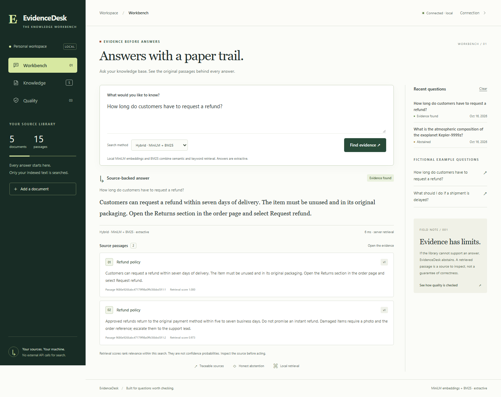

# EvidenceDesk

Support answers should come with inspectable evidence. EvidenceDesk indexes text policies and runbooks, retrieves relevant passages with a real local sentence-transformer model and a BM25 baseline, and returns a source excerpt or an explicit refusal when evidence is weak.

It is a complete single-workspace application with document revisions, optimistic concurrency, deletion, query history, a browser workbench, and a reproducible evaluation harness. Answers are **extractive source text**. There is no generative LLM, paid inference API or claim of customer adoption.



## Run locally

Requires Python 3.12 or newer. Node is needed only for browser tests. The first semantic ingestion downloads the public MiniLM model; subsequent inference uses the local cache. No API key is required. Do not ingest confidential data on a shared machine.

```powershell
python -m venv .venv
.\.venv\Scripts\Activate.ps1
python -m pip install -c requirements.lock -e '.[dev]'
python -m evidencedesk
```

On Linux/macOS activate with `source .venv/bin/activate`. Open `http://127.0.0.1:8011`, choose **Load sample knowledge**, then ask a question such as “How long does a refund take?” The five merchant policies are fictional fixtures. You can also add your own text/Markdown, edit a version, inspect citations and remove sources.

For a model-free session, set `EVIDENCE_MODE=bm25` before starting. In PowerShell: `$env:EVIDENCE_MODE='bm25'`. This is a lexical baseline, not a semantic model. A missing semantic model produces an actionable error; it does not silently pretend BM25 was model inference.

## What works

- MiniLM embeddings through FastEmbed and CPU ONNX Runtime; BM25 baseline and weighted reciprocal-rank fusion.
- Source titles, versions, content hashes and chunk references on every citation; immutable query snapshots for revision audit.
- Weak-evidence and instruction-like query refusals. Source text never becomes executable instructions.
- Atomic source revision replacement, duplicate detection, stale-write conflicts, bounded ingestion and SQLite WAL durability.
- Deleting a document also purges retained query snapshots that contain it. History can be cleared independently.
- Basic email and unformatted Indian mobile-number redaction before storage. This is a narrow convenience filter, not comprehensive PII detection or compliance certification.
- Same-origin browser interface, protected API mode, bounded request bodies, host validation, restrictive content policy and explicit local-only default.

## Measure quality

```powershell
python -m pytest -q --cov=evidencedesk
python -m evidencedesk.evaluate
cd ui-tests
npm ci
npx playwright install chromium
npm test
```

The evaluator uses an isolated temporary database and leaves your real knowledge untouched. It writes `reports/evaluation.json`; the Quality view reads that report. A fixed threshold and 4 development / 26 holdout cases compare BM25, dense and hybrid retrieval. The holdout contains 18 answerable questions and 8 unsupported/adversarial questions. See [evaluation methodology](docs/EVALUATION.md) and [execution evidence](docs/VERIFICATION.md) for measured results and failures.

This small author-created set is a regression fixture, not an independent benchmark. Citation integrity means an excerpt matches its stored chunk and version; it does not prove the source is true or that the answer resolves every aspect of a question.

## Architecture and operation

Python/FastAPI handles typed contracts and authentication; SQLite stores sources, chunks, vectors and query snapshots. A static accessible client consumes the same-origin JSON API. Retrieval and persistence are independent of HTTP. The model is initialized lazily and reuses a local CPU session.

See [architecture](docs/ARCHITECTURE.md), [security boundaries](SECURITY.md), [deployment and recovery](docs/OPERATIONS.md), and [API contract](API_CONTRACT.md). OpenAPI is available at `/openapi.json`; interactive API documentation is disabled in the service.

## Deployment

The repository contains a non-root Docker image, loopback-bound Compose configuration, health check and GitHub Actions workflow. Container configuration has been prepared; consult verification for whether Docker was actually executed. Public hosting is approval-gated. An Internet-facing installation requires HTTPS termination, a workspace token, an explicit allowed hostname, persistent storage, request limiting at the proxy and an owner who controls access.

This is a bounded, single-workspace service: at most 100 documents and 2,000 chunks. There is no multi-tenant security model, distributed vector database, multi-node scheduler, legal policy authority, or production load claim. SQLite and in-process ranking intentionally keep this portfolio deployment understandable and inexpensive.

## Project ownership

Personal portfolio project for Deboraj Sarkar, developed with Codex-assisted implementation and executable review. The repository demonstrates application behavior; it does not establish prior AI employment or independently assessed individual proficiency. [Engineering walkthrough](docs/WALKTHROUGH.md) records the concepts to explain and extend without assistance.

Code is MIT licensed. Model weights have their own Apache 2.0 license and upstream attribution in [third-party notices](THIRD_PARTY.md).
